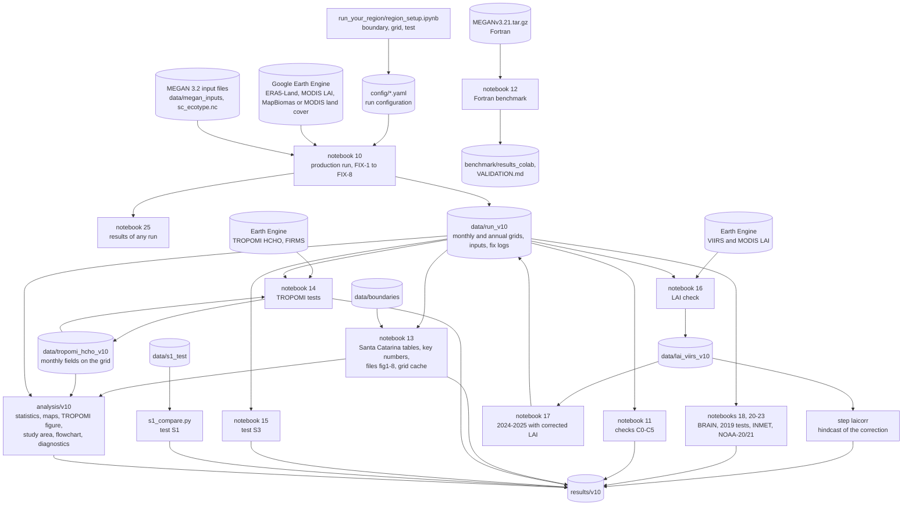

# 4. The pipeline

The work runs in two halves. The first half needs Earth Engine: notebook 10 reads the inputs and runs the model for the
region and period of a run configuration (`config/*.yaml`), and notebook 14 reads the TROPOMI columns. The second half
needs only their products: notebook 11 checks a run, notebook 25 computes the standard results of any run, and, for the
Santa Catarina example, notebooks 13, 14 (from its cache) and 15 and the scripts of `analysis/v10/` compute every table,
number and figure of `results/v10/`.

Two routes go through this pipeline:

* **the Santa Catarina example** (`config/santa_catarina_2003_2025.yaml`): its first half is shipped in `data/` (the
  release archives), so `reproduce.py` reruns the second half on any computer (chapter 5), and notebook 10 can rerun the
  first half (chapter 6);
* **any other region and period**: the region wizard (`run_your_region/region_setup.ipynb`) writes the configuration,
  then notebooks 10, 11 and 25 run in that order with it (chapter 8).

For the example, notebooks 16 and 17 give 2024 and 2025 a VIIRS-corrected LAI in place of the MODIS LAI, and notebooks
18 and 20 to 23 hold the comparison with the BRAIN inventory of 2019 and the tests of that year.

## 4.1 Map

## 4.2 What each step reads and writes

| Step | Reads | Writes | Runs where |
|---|---|---|---|
| Region wizard | a boundary file; Earth Engine (a test of a few days) | `config/<region>_run.yaml`, `data/regions/<region>/` (ecotype map of the region) | Colab |
| Notebook 10 | a run configuration; Earth Engine (ERA5-Land hourly, MODIS LAI, MapBiomas or MODIS land cover), `data/megan_inputs`, the ecotype map, the boundary | `<OUT_BASE>/<output.dir>/<year>/...`; for the example `megan_sc_outputs_v10/<year>/...` = `data/run_v10` | Colab, or Jupyter with Earth Engine |
| Notebook 11 | the run and its configuration | `verify_v10_report.csv`, annual totals | anywhere |
| Notebook 25 | the run and its configuration | `results/`: monthly and annual totals, seasonal cycle, maps of mean intensity, drivers, correlations, trends, zone totals | anywhere |
| Notebook 12 | `MEGANv3.21.tar.gz`, the engine, the 2019 inputs | `benchmark_summary.csv` and stage files | Colab (Linux) |
| Notebook 13 | the run, `data/boundaries` | tables of the Santa Catarina example, `key_numbers.csv`, files `fig1-8.png` and `fig_detrend.png`, `annual_grids_cache.npz` | anywhere |
| Notebook 14 | the run (2019-2025); Earth Engine (TROPOMI, FIRMS) unless the cache is present | the cache of monthly fields, the four tests, the monthly series | Colab, or anywhere with the cache |
| Notebook 15 | the fix logs of the run | test S3 | anywhere |
| `analysis/v10/*` | the run, the outputs of notebook 13, the TROPOMI cache, the boundaries | diagnostics, statistics by class, mesoregion and municipality, maps, the TROPOMI figure, the study-area map and the verification flowchart, additional diagnostics | anywhere |
| Notebook 16 | the run (grid, growth forms, MODIS LAI), `data/boundaries`; Earth Engine (VIIRS VNP15A2H, MODIS MCD15A3H) | monthly VIIRS and MODIS LAI on the grid, 2013-2025 = `data/lai_viirs_v10` | Colab |
| step `laicorr` | the MODIS-LAI record of every year (`tools/lai_variant_view.py`), `data/lai_viirs_v10` | hindcast of the candidate corrections, corrected LAI of 2024-2025 (`lai_viirs_check/`) | anywhere |
| Notebook 17 | the run, the cache of 16; Earth Engine (ERA5-Land) | 2024 and 2025 with the corrected LAI, installed in the run on request | Colab |
| Notebook 19 | outputs of 10, 16 and 17, the release archives of the run | installation of 2024-2025 (MODIS years to `data/run_v10_modis_lai_2024_2025`), NOAA CO₂ file, `reproduce.py` with both LAI (run once by the authors) | Colab |
| Notebook 18 | the run of 2019, `data/boundaries`, MEGANv3.21 tables, the BRAIN files | comparison with BRAIN (`results/v10/brain_comparison`) | Colab or anywhere |
| Notebook 21 | INMET station lists and records; Earth Engine | ERA5-Land against the stations, lapse rate (`results/v10/era5land_vs_inmet`) | Colab |
| Notebook 20 | the run of 2019, the lapse rate of 21; Earth Engine | one-at-a-time runs of 2019 (`results/v10/sensitivity_2019`) | Colab |
| Notebook 22 | the run, the cache of 16; Earthdata | Suomi NPP, NOAA-20 and NOAA-21 LAI, corrections recomputed (`results/v10/lai_noaa20_check`) | Colab |
| Notebook 23 | the state of 18, optionally the outputs of 14, 20 and 21 | tests of the differences from BRAIN (`results/v10/brain_differences`) | Colab or anywhere |

Notebook 10 writes isoprene as the MEGANv3.21 code computes it. Every number of `results/v10` that contains isoprene
includes the factor ρ = 0.96 (chapter 1, section 1.1): notebooks 11, 13, 14 and 15, `analysis/v10/s1_compare.py`,
`analysis/v10/report/10_report_numbers_v10.py` and the C3 diagnostics apply it when they read the run, and the other scripts read the outputs of
notebook 13 or compute ratios that the factor does not change. Notebook 13 and `analysis/v10/common.py` split the
emission of each cell among the municipalities and mesoregions in proportion to the area of the cell inside each
polygon (`area_weights`).

`analysis/v10/README.md` lists every script, and chapter 5 the order in which `reproduce.py` runs them.

## 4.3 Inside notebook 10

The notebook first reads the run configuration, writes `src/megan_sc/fixes.py` from the copy embedded in the notebook
and records its hash (a933b29602929a82), installs the engine patches (FIX-6, FIX-7, FIX-8), fills the ecotype no-data
pixels (FIX-5) and builds the grid, the region mask (cells whose centre lies inside the boundary) and the zones. Then,
for each year, it:

1. reads the growth forms of the year from the land-cover source of the configuration (MapBiomas or MODIS MCD12Q1; the
   nearest year of the product when the year lies outside its range) or reuses a cached copy, builds the emission
   factors and the canopy types, and saves them (`growthform_*.npz`, `ef_*.npz`);
2. for each month of the period: reads the monthly MODIS LAI of the month and of its neighbours and fills the gaps (FIX-4); for each
   day, reads the eight 3-hourly ERA5-Land fields and the 24-h mean temperature (FIX-2), fills the coastal cells
   (FIX-1) and runs `fixes.run_timestep_fixed` with the previous month's LAI (FIX-3); accumulates tonnes, the
   meteorology, the diurnal profile and the fix log; saves a checkpoint after every step;
3. writes the monthly files, then the annual sum and the regional totals; a short check at the end looks for forested
   cells without isoprene, the signature of a cell computed without valid meteorology (check C1 of notebook 11).

The checkpoints make the notebook resumable: after a Colab disconnection, running all cells again skips the finished
months and resumes the current one.

## 4.4 Provenance

Four things tie every number of `results/v10` to the code that produced it, and the first three hold for any run:

* the hash prefix of `fixes.py` (a933b29602929a82), stored in the global attributes of every emission file and in
  every `provenance_v10.json`, and checked by notebook 11 (check C0);
* the percent-format sources of the notebooks (`notebooks/src/*.py`), from which the `.ipynb` files are built;
* the logs: `results/v10/notebook13_meso2024/run_nb13.log`, `results/v10/final_review/final_review.log`,
  `results/v10/diagnostics/*.log`, and those of `reproduce.py` in `reproduced/logs/`;
* `reproduce.py compare`, which checks that the published files are what the code computes from the shipped run.

## 4.5 How `reproduce.py` runs the notebooks

`tools/run_notebook.py` executes the code cells of a notebook in one Python namespace, as Colab would, with four
differences: `google.colab` is replaced by a stub, `%pip` and `!` lines are skipped, the settings of the first cell
are replaced by values given on the command line (the folders of the repository), and matplotlib writes figures to
files. It also tells the setup block of the notebook that it runs outside Colab and where the repository is.
`reproduce.py` builds the values from `_paths.py`. For notebook 14 it copies the shipped monthly fields into the
notebook's cache folder, so the notebook skips Earth Engine.

`tools/offline_run.py` runs notebook 10 the same way with Earth Engine replaced by deterministic synthetic fields
(hourly meteorology with a daily cycle and a strip of cells without data, monthly LAI, growth forms). The engine, the
procedures FIX-1 to FIX-8, the emission factors and every file written are the real ones, while the numbers mean
nothing physically. The test `tests/test_offline_run.py` uses it to run notebooks 10, 11 and 25 for a small region
without an Earth Engine account.
